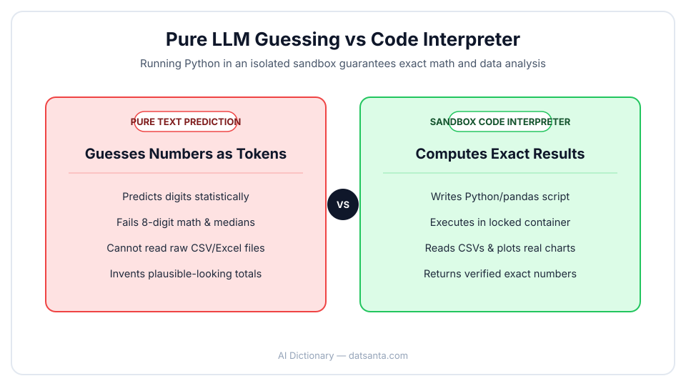

# Code Interpreter

A **code interpreter** is a secure, isolated [sandbox](sandbox.md) tool attached to an LLM that lets the model write and execute Python or shell code on the fly to do exact math, analyze CSV files, or plot charts.

## Everyday example

Asking a pure language model to multiply two 8-digit numbers or find the median of 5,000 spreadsheet rows by guessing tokens invites arithmetic errors. With a code interpreter, the LLM writes a 5-line `pandas` script, runs it inside a locked container, reads the exact computed result (`$142,890.50`), and reports verified numbers instead of guessing.

## Don't confuse with

- **[Computer Use](computer-use.md):** Computer use clicks around a visual desktop GUI; a code interpreter runs headless scripts inside a sandboxed terminal and returns stdout or generated files.

## Related terms

- [Sandbox](sandbox.md)
- [Function Calling](function-calling.md)
- [Hallucination](hallucination.md)
