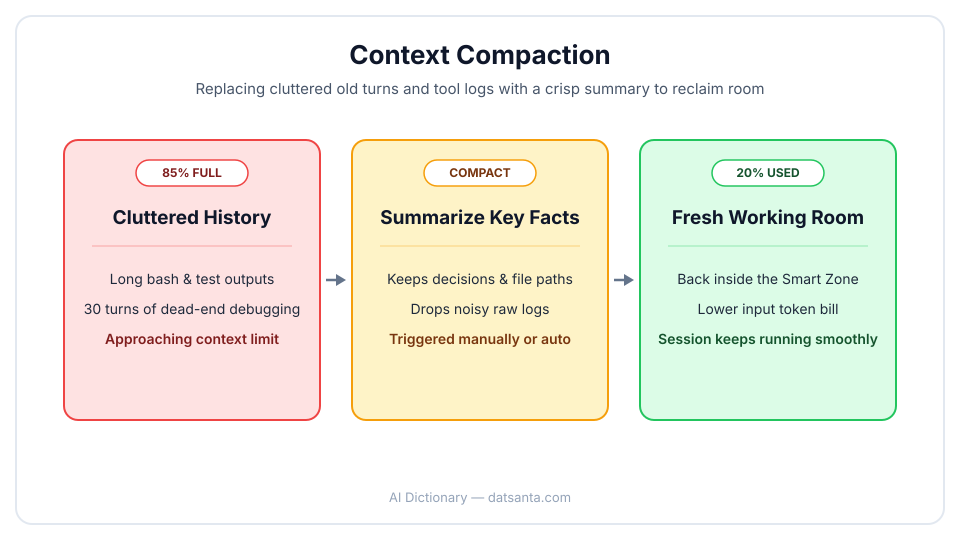

# Compaction (Context Compaction)

**Compaction** is summarizing and replacing older turns, tool logs, and file dumps in an AI coding session with a compact recap so the conversation can keep running without overflowing the [context window](context-window.md).

## Everyday example

Imagine a whiteboard covered in three hours of messy debugging scribbles, error logs, and dead-end hypotheses. Before running out of space, you snap a clean five-bullet summary of what you learned and wipe the rest of the board so you can think clearly again. Coding [harnesses](harness.md) often run **autocompact** automatically when context usage nears ~80%, trading raw verbatim history for fresh working room.

## Don't confuse with

- **[Handoff Artifact](handoff-artifact.md):** Compaction compresses history inside the *same* live session; a handoff artifact writes a structured note to disk so a *brand-new* session can start cleanly with zero leftover clutter.

## Related terms

- [Smart Zone](smart-zone.md)
- [Context Rot](context-rot.md)
- [Harness](harness.md)
