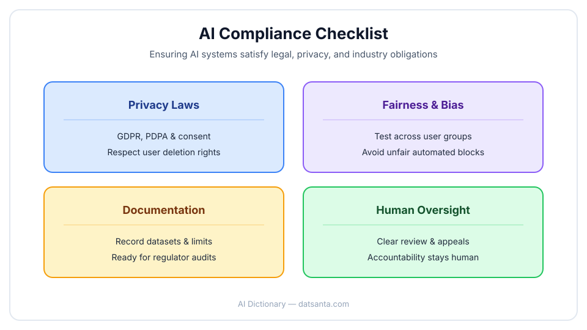

# Compliance

**Compliance** means making sure your company's AI tools, data handling, and automated decisions follow all applicable laws, industry standards, and customer contracts.

## Everyday example

A restaurant cannot just cook tasty food; it also has to pass health inspections, label allergens, and follow fire safety codes. Similarly, a bank or clinic cannot deploy an AI loan-screening or triage tool just because it is accurate. It must prove the tool respects privacy laws, avoids illegal discrimination, keeps proper records, and meets industry rules before going live.

## Don't confuse with

- **[Data Governance](data-governance.md):** Data governance is how you organize and control data internally; compliance is proving you meet external legal and regulatory requirements.

## Related terms

- [EU AI Act](eu-ai-act.md)
- [Audit Trail](audit-trail.md)
- [Model Risk Management](model-risk-management.md)
