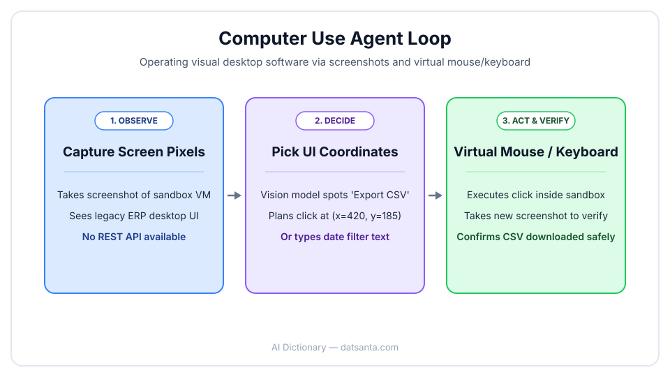

# Computer Use

**Computer use** is an agent capability where a multimodal model looks at screenshots of a graphical user interface (GUI) and operates a virtual mouse and keyboard—clicking buttons, typing, and scrolling like a human operator.

## Everyday example

Many legacy enterprise systems (old ERP apps, desktop billing tools, or partner portals) have no clean REST API or [MCP](mcp.md) connector. Instead of giving up, a computer-use agent takes a screenshot, spots the `"Export CSV"` button at coordinates `(420, 185)`, clicks it inside an isolated [sandbox](sandbox.md), and verifies the next screen—automating software built strictly for human eyes.

## Don't confuse with

- **[Function Calling](function-calling.md):** Function calling invokes structured backend APIs directly via JSON (fast and reliable); computer use visually clicks pixels on a screen when no API exists.

## Related terms

- [Sandbox](sandbox.md)
- [Function Calling](function-calling.md)
- [AI Agent](ai-agent.md)
