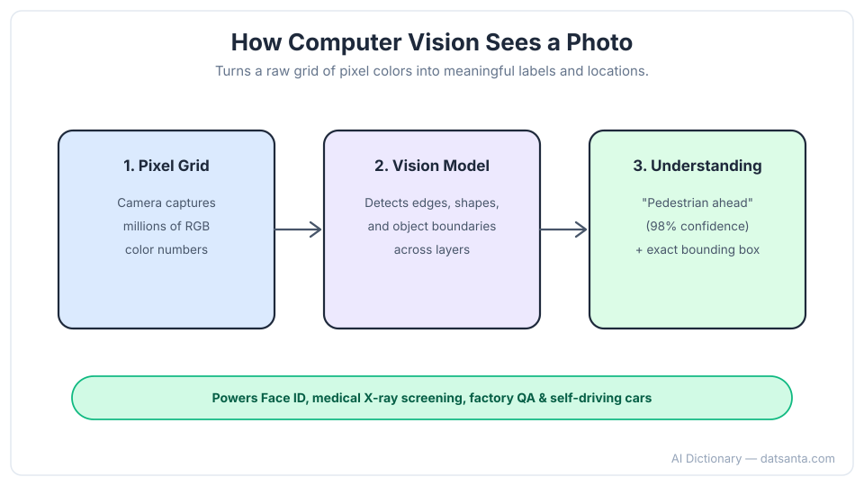

# Computer Vision

**Computer vision** is the field of AI that teaches computers to "see" and understand photos and videos — identifying objects, faces, text, and movement from raw pixels.

## Everyday example

When your phone unlocks with Face ID, your photo app groups pictures of your dog automatically, or a car warns you about a pedestrian ahead, computer vision is doing the work.

To a computer, a photo is just a giant grid of color numbers. Computer vision models scan that grid through [deep learning](deep-learning.md) layers to spot edges, shapes, and finally objects (*"pedestrian, 98% confidence"*).

## Don't confuse with

- **[Text-to-image](text-to-image.md):** Text-to-image *creates* new pictures from words; computer vision *reads and understands* existing photos or camera feeds.
- **Simple camera filters:** Brightening a photo or adding a sepia tint adjusts pixels blindly; computer vision actually knows what is inside the scene.

## Related terms

- [Deep Learning](deep-learning.md)
- [Multimodal AI](multimodal-ai.md)
- [Neural Network](neural-network.md)
- [Text-to-Image](text-to-image.md)
