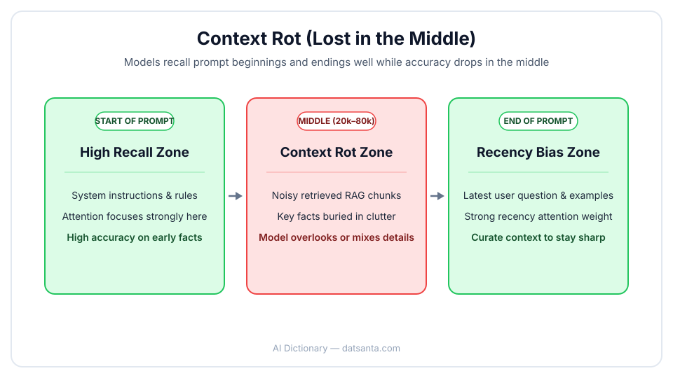

# Context Rot

**Context rot** (often called "lost in the middle") is the gradual drop in LLM reasoning accuracy and instruction-following as prompts fill up with long, noisy, or conflicting context—even before hitting the max token limit.

## Everyday example

Even if a meeting room fits 50 people, trying to hold a crisp decision meeting with 48 people talking over each other causes everyone to miss key details buried in minute 35. LLMs behave similarly: they recall facts at the very start and very end of a prompt well, while facts buried in a 60,000-token middle get ignored. Trimming stale chat history and curating [RAG](rag.md) chunks prevents context rot.

## Don't confuse with

- **[Context Window](context-window.md):** Context window is the maximum technical capacity a model accepts; context rot is the practical degradation in quality well before that limit is reached.

## Related terms

- [Needle-in-a-Haystack Test](needle-in-a-haystack.md)
- [Context Window](context-window.md)
- [Reranking](reranking.md)
