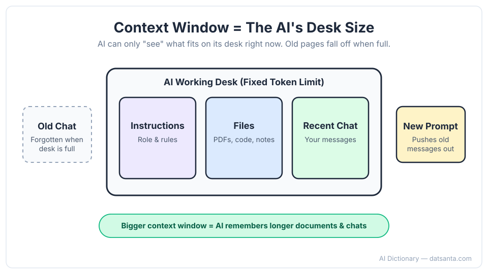

# Context Window

A **context window** is the maximum amount of text (measured in [tokens](token.md)) an AI can hold in mind at one time during a conversation. Anything outside this limit is forgotten.

## Everyday example

Think of the context window as the size of the AI's working desk. Your instructions, uploaded PDFs, and recent chat messages all sit on that desk.

If your conversation gets too long or you drop in a huge book, the desk fills up. To make room for your newest question, the oldest notes slide off the edge — which is why AI sometimes forgets what you told it 30 messages ago.

## Don't confuse with

- **Long-term memory:** A context window only lasts for the current chat; once the chat grows past the limit or you open a new thread, it resets.
- **Training data:** What the AI learned before it was released; the context window is only what you put in front of it right now.

## Related terms

- [Token](token.md)
- [Prompt](prompt.md)
- [LLM](llm.md)
- [RAG](rag.md)
