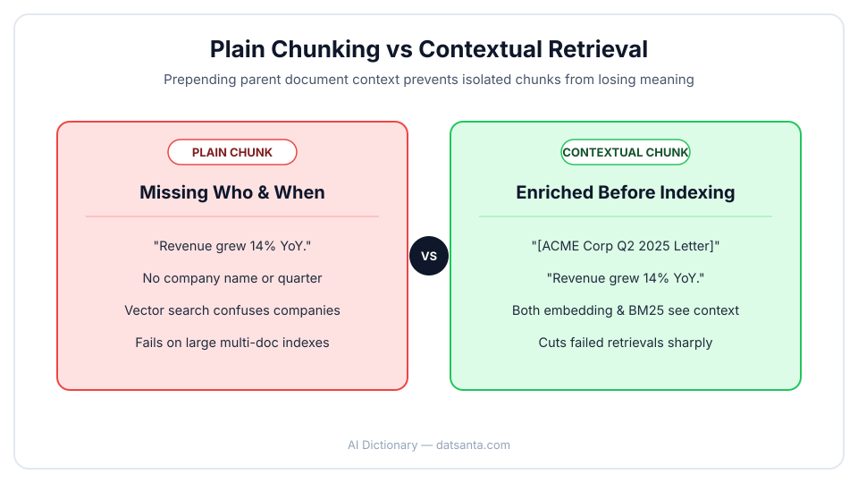

# Contextual Retrieval

**Contextual retrieval** prepends a short, LLM-generated summary header to every document chunk *before* indexing it, so isolated chunks never lose who, what, or which document they belong to.

## Everyday example

If a chunk reads `"Revenue grew 14% year-over-year due to strong enterprise renewals"`, vector search alone has no idea *which company* or *which quarter* that sentence came from. Contextual retrieval prepends `"From ACME Corp Q2 2025 Shareholder Letter, Financial Highlights:"` to the chunk before embedding and BM25 indexing—dramatically reducing failed retrievals on large document sets.

## Don't confuse with

- **[Chunking](chunking.md):** Chunking splits a document into smaller pieces; contextual retrieval enriches each split chunk with parent-document context prior to indexing.

## Related terms

- [Chunking](chunking.md)
- [Hybrid Search](hybrid-search.md)
- [RAG](rag.md)
