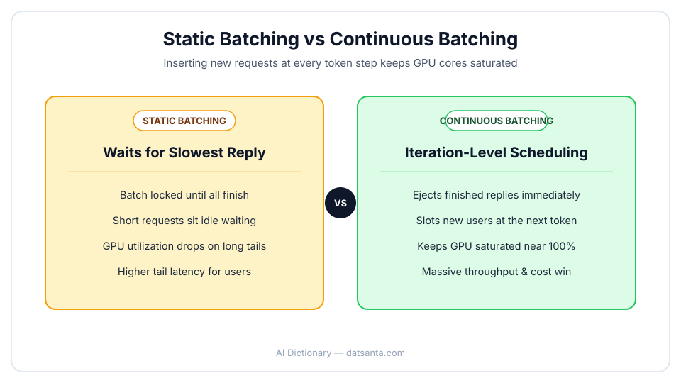

# Continuous Batching

**Continuous batching** (iteration-level scheduling) lets an inference server add new user requests into an active GPU batch and release finished requests immediately at *every single token step*, instead of waiting for the longest reply in a batch to finish.

## Everyday example

A traditional static-batch bus refuses to let anyone board or exit until every single passenger reaches the final stop—if one passenger rides for 100 stops while nine others only need 5 stops, nine seats sit empty for 95 stops. Continuous batching lets passengers hop on and off at every stop (every token generated), keeping GPU utilization near 100% and boosting [throughput](latency-vs-throughput.md) dramatically.

## Don't confuse with

- **[Latency vs. Throughput](latency-vs-throughput.md):** Throughput is the overall metric of tokens served per second; continuous batching is the scheduling technique that maximizes throughput under concurrent traffic.

## Related terms

- [vLLM](vllm.md)
- [Latency vs. Throughput](latency-vs-throughput.md)
- [Prefill and Decode](prefill-and-decode.md)
