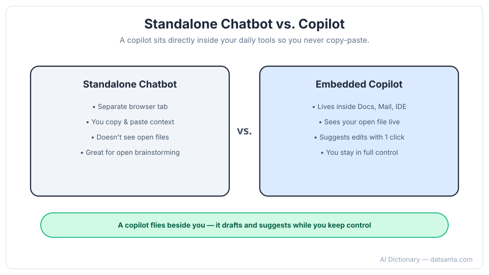

# Copilot

A **copilot** is an AI assistant built directly inside the software you already use — such as your document editor, spreadsheet, email app, or code editor — helping you work faster while you stay in control.

## Everyday example

Instead of leaving your email app, copying text into a separate [chatbot](chatbot.md), and pasting the reply back, a copilot sits right inside your inbox. It already sees the email thread and suggests a draft reply with one click.

Just like a co-pilot in an airplane cockpit, it suggests routes and handles routine checklists while you keep both hands on the controls.

## Don't confuse with

- **Autopilot / [AI agent](ai-agent.md):** A copilot assists *alongside* you and waits for your approval; an agent runs multi-step tasks more independently in the background.
- **[Chatbot](chatbot.md):** A chatbot lives in its own separate chat tab; a copilot lives inside your workspace and sees your open document or code automatically.

## Related terms

- [Chatbot](chatbot.md)
- [Human-in-the-Loop](human-in-the-loop.md)
- [AI Agent](ai-agent.md)
- [AI Workflow](ai-workflow.md)
