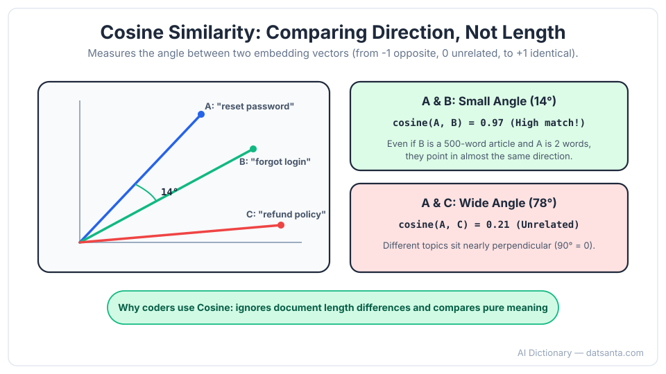

# Cosine Similarity

**Cosine similarity** measures how close two [embedding](embeddings.md) vectors point in the same direction, returning a score from `-1` (opposite) to `0` (unrelated) to `+1` (identical meaning) regardless of text length.

## Everyday example

Suppose one vector represents the 2-word query `"reset password"` and another represents a 500-word help article on *"forgot your login."* Their arrow lengths differ wildly, yet both point in nearly the same semantic direction (say a `14°` angle, cosine `0.97`).

Meanwhile, `"refund policy"` points nearly sideways (`78°`, cosine `0.21`). By measuring angle instead of length, cosine similarity compares pure topic match cleanly.

## Don't confuse with

- **Euclidean distance (L2):** Euclidean distance measures straight-line gap between tips, which can be skewed by vector length unless vectors are normalized first.
- **Keyword overlap:** Cosine similarity works even when two texts share zero identical words (like `"car"` and `"automobile"`).

## Related terms

- [Embeddings](embeddings.md)
- [Vector Database](vector-database.md)
- [Hybrid Search](hybrid-search.md)
