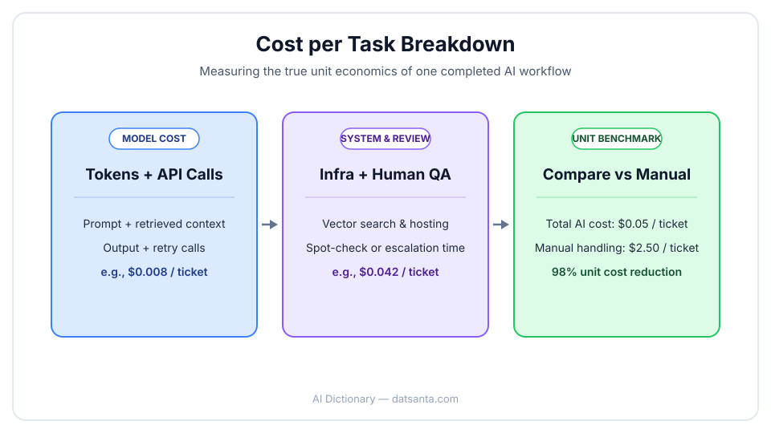

# Cost per Task

**Cost per task** is the total amount of money spent to complete one specific unit of work with AI—such as answering one support ticket, summarizing one call, or drafting one product description.

## Everyday example

Instead of asking how much your delivery van costs per month, you calculate how much it costs to deliver one package, including fuel, driver time, and maintenance. With AI, a cheap model might cost $0.002 per support reply, while a heavy reasoning workflow with human review costs $0.15 per ticket. Knowing your cost per task lets you compare AI directly against manual work and decide if automation makes financial sense.

## Don't confuse with

- **[TCO (Total Cost of Ownership)](tco.md):** TCO tracks the whole system cost over a year or more; cost per task zooms in on the unit price of a single completed output.

## Related terms

- [Token Budget](token-budget.md)
- [AI ROI](ai-roi.md)
- [Service Tiering](service-tiering.md)
