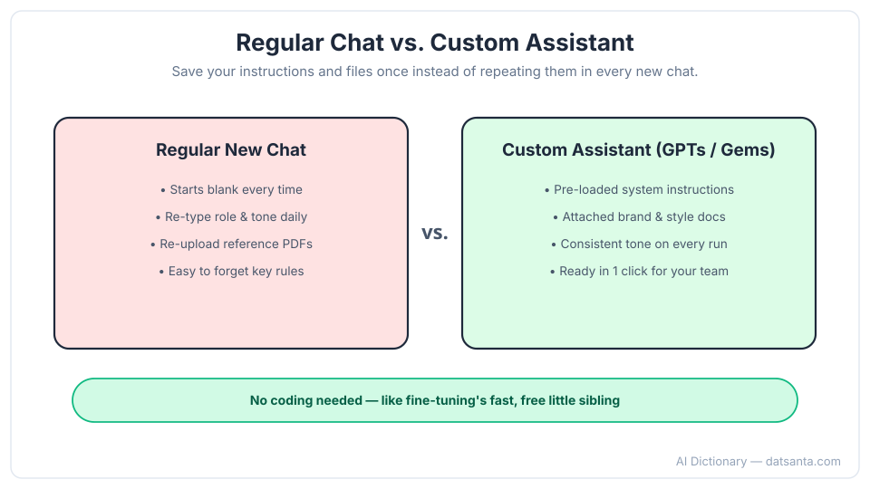

# Custom Assistant

A **custom assistant** (such as Custom GPTs, Gemini Gems, or Claude Projects) is a personalized version of an AI [chatbot](chatbot.md) pre-loaded with your own instructions, tone, and reference files so you do not have to repeat yourself every chat.

## Everyday example

Instead of typing *"Act as an English editor, keep my casual tone, and check against our style guide"* every morning, you save those rules and your style PDF once inside a Custom Assistant.

Every time you open that assistant, it already knows your role, your rules, and your files — just like a teammate who remembers your preferences from day one.

## Don't confuse with

- **[Fine-tuning](fine-tuning.md):** Fine-tuning retrains the AI model's internal [parameters](parameters.md) using code and GPUs; a custom assistant simply saves a [system prompt](system-prompt.md) and files around an existing model in minutes.
- **Regular chat thread:** A normal chat thread forgets your setup as soon as you click "New Chat" or hit the [context window](context-window.md) limit.

## Related terms

- [Chatbot](chatbot.md)
- [System Prompt](system-prompt.md)
- [RAG](rag.md)
- [Fine-tuning](fine-tuning.md)
