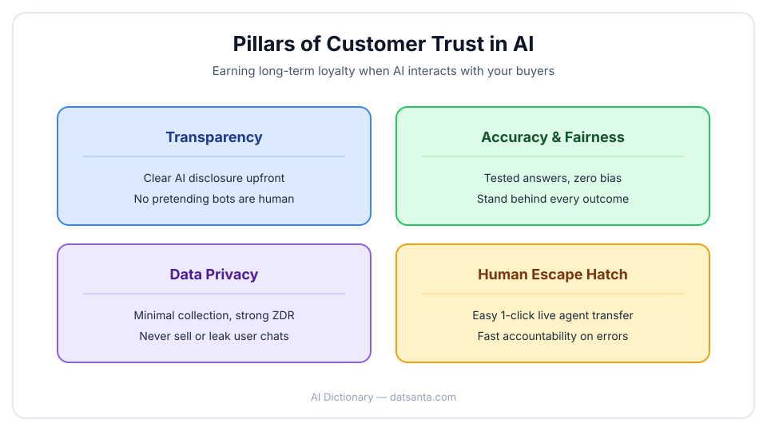

# Customer Trust

**Customer trust** is the confidence buyers have that your company uses AI honestly, protects their personal data, and stands behind every AI-assisted answer, price, or decision.

## Everyday example

A customer who discovers a hidden chatbot gave them wrong refund rules—and nobody takes responsibility—quickly loses faith in the whole brand. On the other hand, companies that clearly label AI support, let customers reach a real human easily, and protect private data often earn *more* trust because service becomes faster and fairer. Trust takes years to build and one bad AI incident to damage.

## Don't confuse with

- **[AI Disclosure](ai-disclosure.md):** Disclosure is the specific act of telling users when AI is involved; customer trust is the broader long-term confidence built through accuracy, fairness, privacy, and accountability.

## Related terms

- [AI Disclosure](ai-disclosure.md)
- [Escalation Path](escalation-path.md)
- [PII](pii.md)
