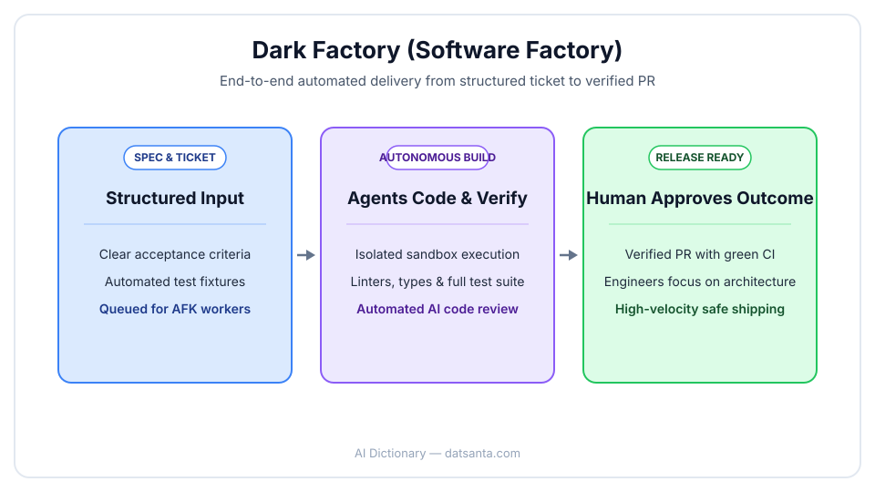

# Dark Factory (Software Factory)

A **dark factory** is a highly automated software delivery setup where AI agents pick up well-defined tickets, write code, run tests, review pull requests, and prepare releases end-to-end with minimal human hands-on coding.

## Everyday example

The term comes from "lights-out" manufacturing plants where robotic arms assemble car parts even with the factory lights turned off. In software engineering, a dark factory combines strict [specs](spec.md), [AFK agents](afk-agent.md), isolated [sandboxes](sandbox.md), and bulletproof automated tests—so engineers spend their time designing systems and reviewing outcomes rather than typing boilerplate.

## Don't confuse with

- **[Vibe Coding](vibe-coding.md):** Vibe coding is informal, ad-hoc prompting by one person to prototype fast; a dark factory relies on rigorous specs, CI gates, and automated verification to ship production-grade code safely.

## Related terms

- [AFK Agent](afk-agent.md)
- [Automated Code Review](automated-review.md)
- [Spec](spec.md)
