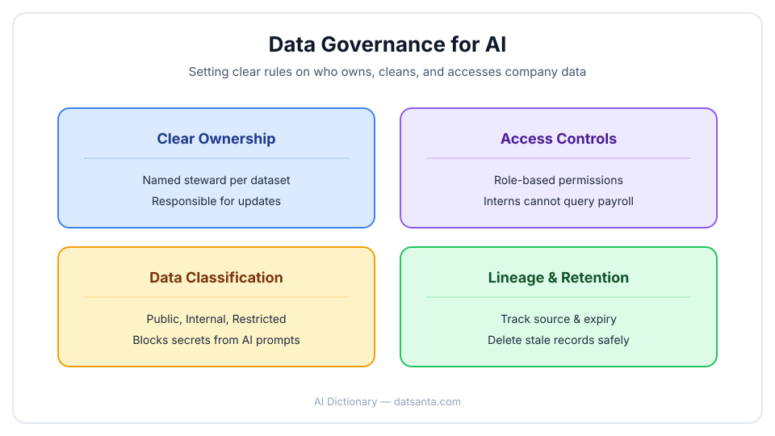

# Data Governance

**Data governance** is the set of company rules, ownership, and access controls that decide who can view, edit, clean, and feed business data into AI tools.

## Everyday example

A company archive room does not leave payroll files, customer contracts, and public brochures unlocked on the same table for anyone to photocopy. There is a librarian, clear labels, and a list of who holds keys to each cabinet. Data governance does the same digitally before you connect AI: it ensures an intern's HR chatbot never accidentally reads executive salary spreadsheets.

## Don't confuse with

- **[Compliance](compliance.md):** Compliance is following external laws and industry regulations; data governance is your internal system for organizing, protecting, and assigning ownership over data.

## Related terms

- [Data Quality](data-quality.md)
- [PII](pii.md)
- [Audit Trail](audit-trail.md)
