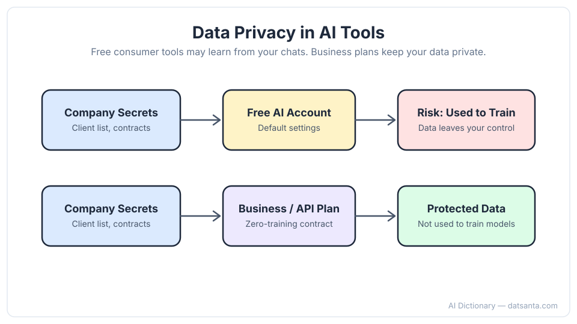

# Data Privacy (AI)

**AI data privacy** is about where your company's confidential information goes when employees type or upload it into an AI tool — and whether the AI provider can store it or use it to train future models.

## Everyday example

Writing a client's salary details on a public café whiteboard is very different from locking them in your office safe.

Free consumer AI accounts often keep chat history to improve their models by default. Business or enterprise AI plans include contractual guarantees that your prompts and uploaded files stay private and are never used to train public models.

## Don't confuse with

- **Account login password:** Having a strong password protects your login, not whether the AI vendor retains or learns from what you paste inside the chat.
- **[AI governance](ai-governance.md):** Data privacy is one core requirement; governance covers the full set of company rules, approved tools, and accountability.

## Related terms

- [Shadow AI](shadow-ai.md)
- [AI Governance](ai-governance.md)
- [RAG](rag.md)
