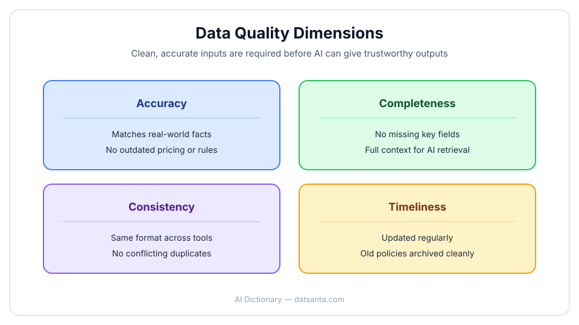

# Data Quality

**Data quality** measures how accurate, complete, up-to-date, and consistent your company's records are—determining whether an AI system gives reliable answers or confidently repeats old mistakes.

## Everyday example

If a warehouse inventory sheet lists 500 winter coats in stock, but 200 were actually sold last month and never subtracted, even the smartest inventory AI will tell customers you can ship orders you do not have. "Garbage in, garbage out" is doubly true for AI: messy, duplicated, or outdated PDFs and spreadsheets make AI look broken when the real problem is dirty source data.

## Don't confuse with

- **[Data Silo](data-silo.md):** A silo means data is isolated in separate systems; data quality is whether the information inside those systems is actually trustworthy and clean.

## Related terms

- [Data Governance](data-governance.md)
- [AI Readiness](ai-readiness.md)
- [RAG](rag.md)
