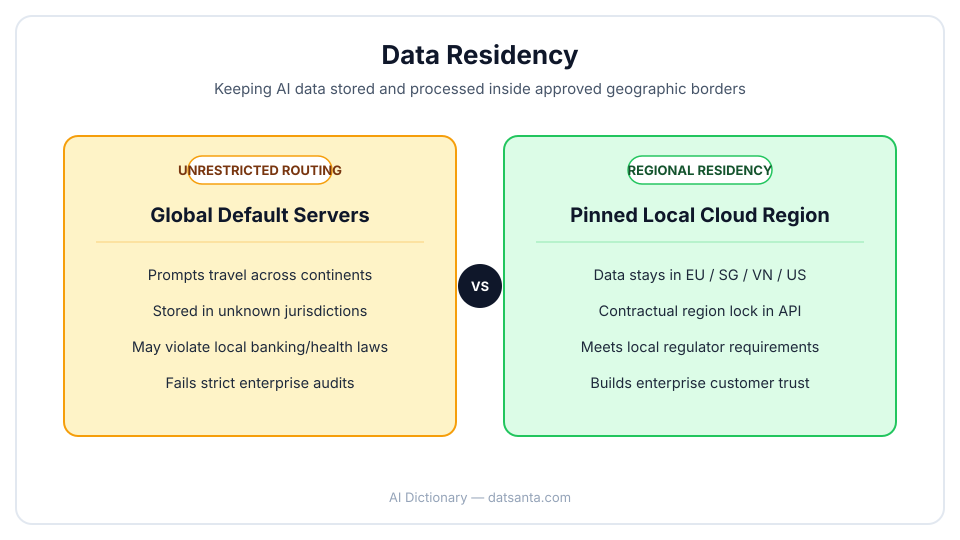

# Data Residency

**Data residency** is the legal or company requirement that business and customer data processed by AI must stay stored inside a specific country or geographic region.

## Everyday example

A European bank or a Vietnamese hospital often cannot send patient or financial records to a server sitting in another continent just because an AI tool is hosted there. Just like storing physical tax archives inside a local branch vault, data residency rules require picking cloud regions—such as Frankfurt, Singapore, or Tokyo—so prompts and stored files never cross restricted borders.

## Don't confuse with

- **[Zero Data Retention](zero-data-retention.md):** Data residency controls *where* servers are physically located; zero data retention controls *whether* the AI vendor saves your inputs at all after answering.

## Related terms

- [Compliance](compliance.md)
- [Enterprise Agreement](enterprise-agreement.md)
- [EU AI Act](eu-ai-act.md)
