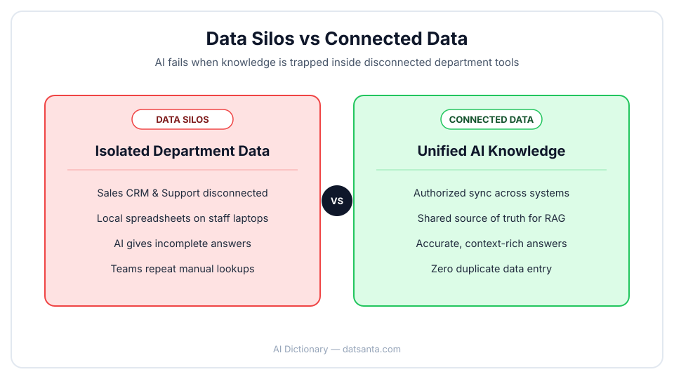

# Data Silo

A **data silo** is a collection of information trapped inside one department or software tool that other teams and AI systems cannot easily access or connect to.

## Everyday example

Imagine a hospital where the reception desk keeps patient phone numbers in a spreadsheet, the lab saves blood test results on a local desktop, and the pharmacy uses a separate system that does not talk to either one. Even if you hire a brilliant assistant, they cannot answer simple patient questions without walking to three different rooms. AI tools fail the same way when company knowledge sits locked inside disconnected silos.

## Don't confuse with

- **[Data Quality](data-quality.md):** Data quality is whether the numbers and records are accurate and clean; a data silo is when good data is trapped in isolation and cannot be shared.

## Related terms

- [Data Governance](data-governance.md)
- [AI Readiness](ai-readiness.md)
- [RAG](rag.md)
