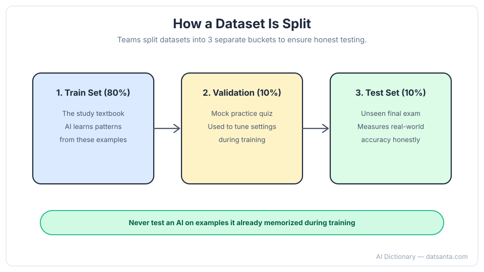

# Dataset

A **dataset** is an organized collection of examples — such as rows in a spreadsheet, labeled photos, or question-and-answer pairs — used to train, test, or evaluate an AI system.

## Everyday example

Think of preparing for a driving exam. You study from a handbook of practice questions (**training split**), check your progress with mock quizzes (**validation split**), and take a brand-new final test you have never seen (**test split**).

AI teams split every dataset the same way. If you accidentally test an AI on the exact examples it already memorized during training, it looks artificially smart until it fails in the real world.

## Don't confuse with

- **A single file or database:** A raw folder of messy PDFs is just files; a dataset is cleaned, structured, and formatted specifically so an AI or [eval](evals.md) script can read it reliably.
- **[Training data](training-data.md):** Training data is only the study portion of a dataset; a complete dataset also sets aside untouched examples for honest testing.

## Related terms

- [Training Data](training-data.md)
- [Evals](evals.md)
- [Benchmark](benchmark.md)
- [Machine Learning](machine-learning.md)
