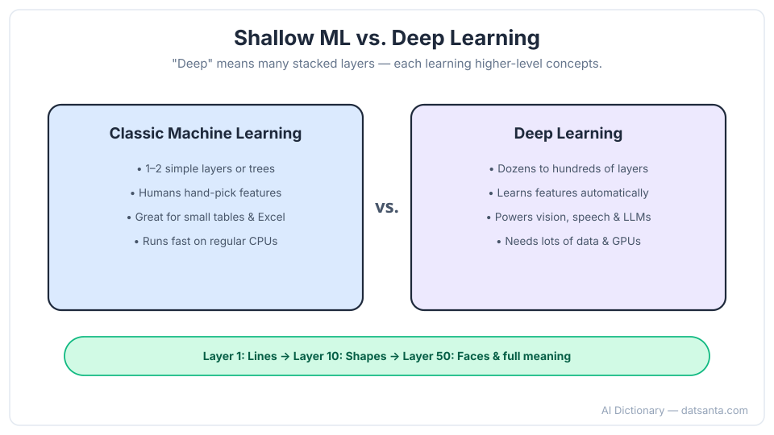

# Deep Learning

**Deep learning** is a branch of [machine learning](machine-learning.md) that uses [neural networks](neural-network.md) with many stacked layers to learn complex patterns — like recognizing faces, translating speech, or writing essays.

## Everyday example

Think of learning to read. First you recognize lines and curves, then letters, then whole words, then full sentences and sarcasm. Each level builds on the one below it.

The word **"deep"** simply refers to having dozens or hundreds of these stacked layers. Earlier layers spot simple clues (pixels or characters), while deeper layers understand high-level meaning (a dog's breed or a joke's punchline).

## Don't confuse with

- **[Machine learning](machine-learning.md):** Machine learning includes simpler methods (like decision trees on spreadsheets); deep learning specifically uses multi-layer neural networks and requires much more data and GPU power.
- **Deep thinking:** "Deep" describes the number of layers in the network, not philosophical intelligence.

## Related terms

- [Neural Network](neural-network.md)
- [Machine Learning](machine-learning.md)
- [Transformer](transformer.md)
- [Training Data](training-data.md)
