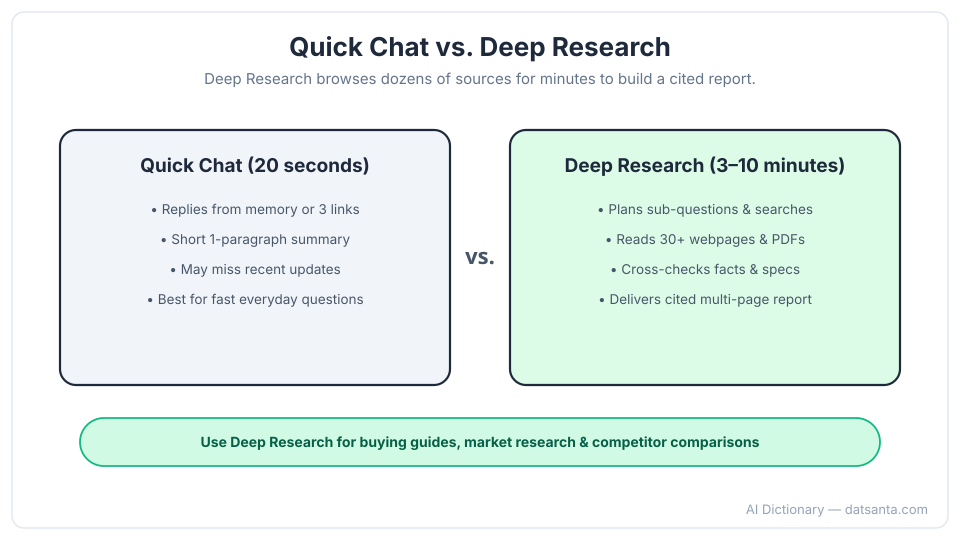

# Deep Research

**Deep research** is an AI feature that spends several minutes browsing dozens of web pages, reading PDFs, cross-checking sources, and writing a structured report with citations — instead of giving a quick one-paragraph chat reply.

## Everyday example

Asking a normal [chatbot](chatbot.md) *"Compare the best electric scooters under $1,000 in 2026"* gives a fast 20-second summary from memory, which may miss recent models or prices.

With Deep Research, the AI acts like a junior analyst: it plans sub-questions, searches 30+ sites, reads spec sheets, compares reviews, and delivers a multi-page report complete with source links you can verify.

## Don't confuse with

- **Quick web search:** Standard search pulls 3–5 links for a fast answer; deep research runs a multi-step [AI agent](ai-agent.md) loop that reads deeply and synthesizes findings.
- **Guaranteed accuracy:** Even cited reports can misread a webpage, so always click key source links before making big decisions.

## Related terms

- [AI Agent](ai-agent.md)
- [RAG](rag.md)
- [Hallucination](hallucination.md)
- [Chatbot](chatbot.md)
