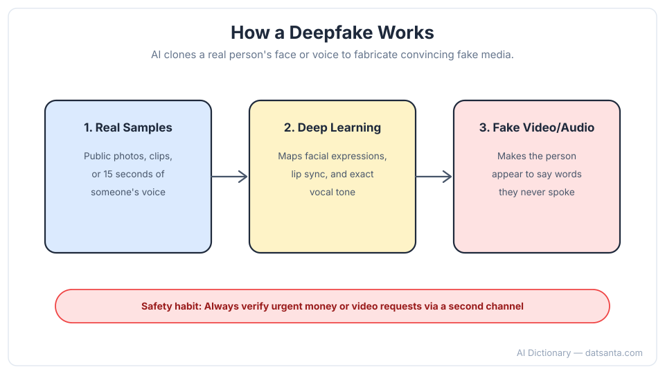

# Deepfake

A **deepfake** is an AI-generated or AI-altered video, photo, or voice recording that makes a real person appear to say or do something they never actually said or did.

## Everyday example

Imagine receiving a panicked phone call that sounds exactly like your family member asking for an urgent bank transfer — or seeing a realistic video clip of a CEO announcing a fake crypto giveaway.

The word combines **[deep learning](deep-learning.md)** and **fake**. While the same technology can dub movies cleanly into other languages, scammers also abuse it, making verification habits essential.

## Don't confuse with

- **Simple photo filters or Photoshop:** Basic filters add glasses or smooth skin visibly; deepfakes synthesize realistic lip movement, facial expressions, and voice tone automatically.
- **[AI watermark](ai-watermark.md):** Watermarks are the defensive labels designed to help people spot AI-generated media like deepfakes.

## Related terms

- [Deep Learning](deep-learning.md)
- [Text-to-Speech](text-to-speech.md)
- [AI Watermark](ai-watermark.md)
- [AI Literacy](ai-literacy.md)
