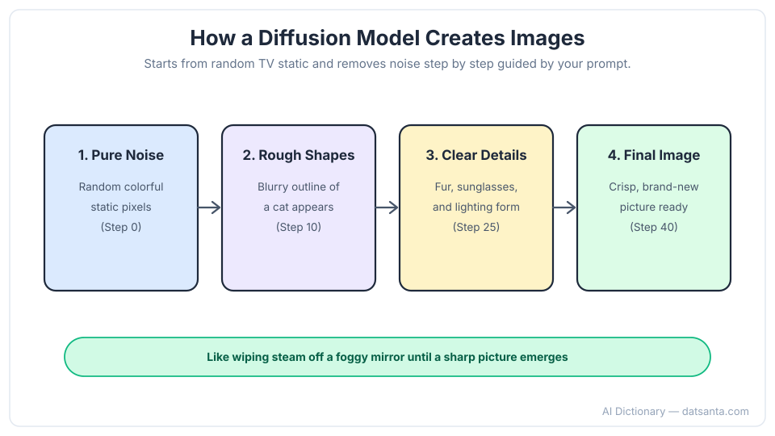

# Diffusion Model

A **diffusion model** is the AI technique behind most modern image and video generators. It creates pictures by starting with random TV-like static and gradually removing noise step by step until a clear image emerges.

## Everyday example

Think of a sculptor carving a marble block — or wiping steam off a foggy bathroom mirror little by little until a crisp face appears.

During training, the AI practices by adding static noise to millions of photos until they turn into pure fuzz, then learns how to reverse the process. When you type *"a cat wearing sunglasses,"* it starts from fresh random static and sculpts out that exact picture over 20–50 tiny steps.

## Don't confuse with

- **[LLM](llm.md):** LLMs generate text one [token](token.md) at a time from left to right; diffusion models refine an entire image all at once across repeated denoising passes.
- **Photo search / Collage:** Diffusion models do not copy-paste existing photos from the internet; they synthesize brand-new pixels guided by learned patterns.

## Related terms

- [Text-to-Image](text-to-image.md)
- [Generative AI](generative-ai.md)
- [AI Watermark](ai-watermark.md)
- [Prompt](prompt.md)
