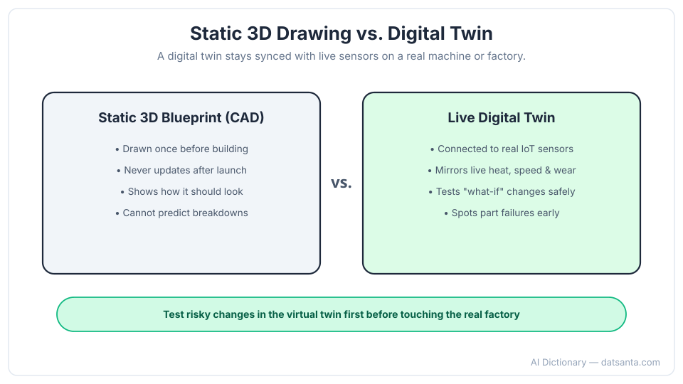

# Digital Twin

A **digital twin** is a live virtual replica of a real-world object, machine, factory, or city that updates continuously from real sensors so teams can test changes safely before touching the physical thing.

## Everyday example

Think of a live 3D video game model of a real wind turbine or warehouse. Sensors on the physical turbine stream temperature, wind speed, and vibration straight into its digital twin.

Engineers and AI models can test *"What happens if we speed up line 3 by 15%?"* or predict when a part will wear out inside the virtual twin first — avoiding costly breakdowns in the real factory.

## Don't confuse with

- **A static 3D CAD drawing:** A CAD blueprint shows how a product looks on day one; a digital twin stays connected to live real-world sensor data over time.
- **A one-off simulation:** A normal simulation runs a theoretical guess; a digital twin mirrors the *actual current state* of one specific physical asset.

## Related terms

- [Synthetic Data](synthetic-data.md)
- [Automation](automation.md)
- [AI](ai.md)
