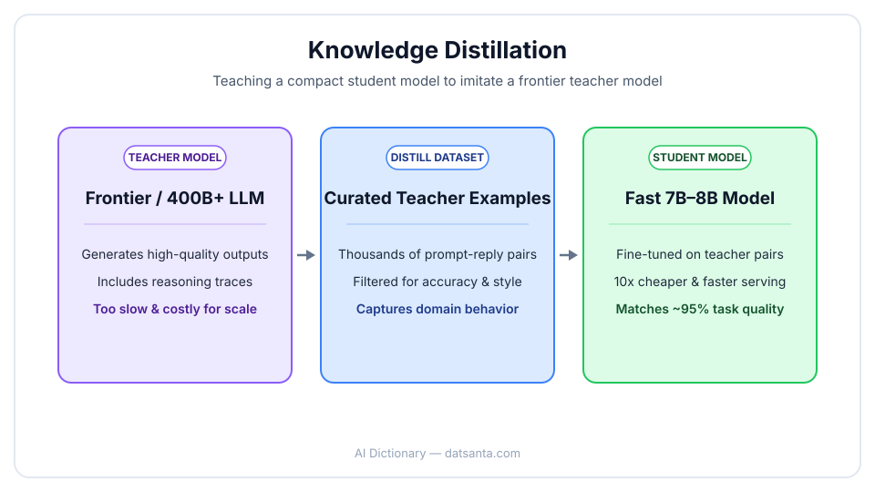

# Knowledge Distillation

**Knowledge distillation** is training a smaller, faster "student" model to mimic the outputs and reasoning patterns of a much larger, more expensive "teacher" model.

## Everyday example

A master pastry chef spends 20 years perfecting recipes through trial and error, then writes down step-by-step techniques so an apprentice can bake 95% as well in just a few weeks. In AI, developers generate thousands of high-quality examples from a frontier model and fine-tune an 8B open-weights model on them—cutting serving latency and API costs by 10x for focused tasks.

## Don't confuse with

- **[Quantization](quantization.md):** Quantization compresses the *same* model by using fewer bits per weight; distillation trains a *brand-new smaller architecture* from scratch or from a smaller base model.

## Related terms

- [LoRA](lora.md)
- [Quantization](quantization.md)
- [Fine-tuning](fine-tuning.md)
