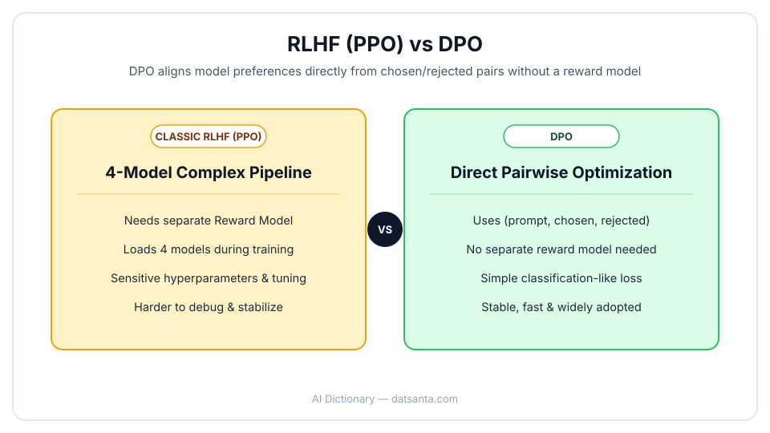

# DPO (Direct Preference Optimization)

**DPO (Direct Preference Optimization)** is a post-training method that aligns a model to prefer helpful, safe answers over bad ones directly from pairs of "chosen vs. rejected" examples—without training a separate reward model.

## Everyday example

In classic [RLHF](rlhf.md), you first train a separate "food critic" model and then use reinforcement learning to please that critic—complex and unstable. With DPO, you simply show the chef pairs of dishes side by side ("customers loved Plate A, hated Plate B") and adjust the recipe directly to increase the odds of Plate A. It achieves similar alignment with far simpler training code.

## Don't confuse with

- **[RLHF](rlhf.md):** RLHF requires training a separate reward model plus PPO reinforcement learning; DPO skips the reward model and optimizes preferences directly with a simpler loss function.

## Related terms

- [RLHF](rlhf.md)
- [Fine-tuning](fine-tuning.md)
- [LoRA](lora.md)
