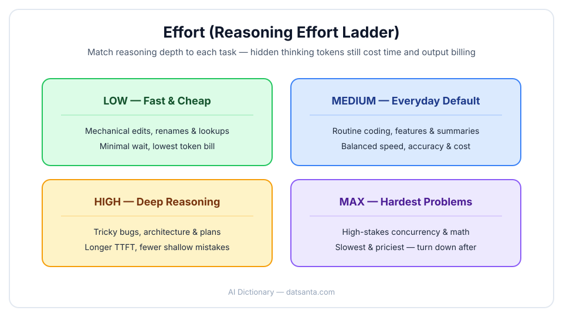

# Effort (Reasoning Effort)

**Effort** is a per-request dial that controls how long a [reasoning model](reasoning-model.md) thinks internally before writing its final answer—trading extra latency and token cost for deeper deliberation.

## Everyday example

Think of asking a senior engineer a question: for `"rename this variable"`, they answer in one second; for `"find this rare race condition"`, they spend ten quiet minutes tracing logs before speaking. Reasoning models work the same way through an effort ladder (`Low`, `Medium`, `High`, `Max`). Even when your app hides the internal thinking trace, those hidden reasoning tokens are generated one by one at inference time and billed as output tokens. Set effort too low on a hard bug and you get a confident, shallow guess; set it to `Max` on a one-line edit and you burn time and money for nothing. Match effort to each task, not the whole session.

## Don't confuse with

- **[Temperature](temperature.md):** Temperature adjusts randomness when sampling the next word; effort adjusts how many reasoning tokens the model spends thinking before answering.
- **[Chain of Thought (CoT)](chain-of-thought.md):** CoT is a prompting technique asking a model to write out steps; effort is a built-in API parameter controlling a reasoning model's internal thinking budget.

## Related terms

- [Reasoning Model](reasoning-model.md)
- [TTFT (Time to First Token)](ttft.md)
- [Token Budget](token-budget.md)
