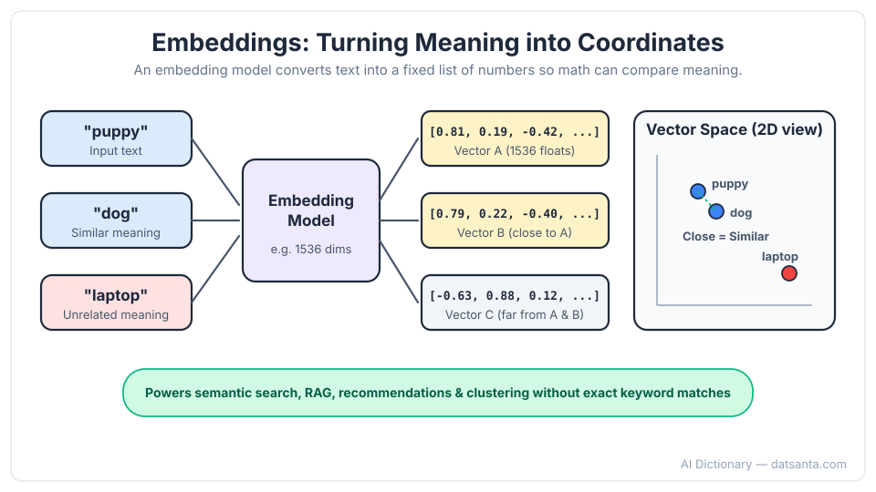

# Embeddings

**Embeddings** convert text, code, or images into fixed-length lists of numbers (vectors) that capture meaning. Texts with similar meaning produce vectors that sit close together in math space.

## Everyday example

Think of GPS coordinates for ideas. A café and a bakery have nearby coordinates on a city map, while a car wash sits miles away — even though the words *"café"* and *"bakery"* share zero letters.

In code, you pass `"puppy"` and `"dog"` through an embedding model and get two 1536-number arrays that score high on [cosine similarity](cosine-similarity.md). That lets your search bar match user intent instead of brittle exact keywords.

## Don't confuse with

- **[Token](token.md) IDs:** Token IDs are just dictionary row numbers (`"dog"` = `9703`) with zero semantic meaning; embeddings encode deep relationships across dimensions.
- **[Vector database](vector-database.md):** Embeddings are the numeric arrays themselves; a vector database is the storage engine that indexes and searches millions of them quickly.

## Related terms

- [Cosine Similarity](cosine-similarity.md)
- [Vector Database](vector-database.md)
- [RAG](rag.md)
- [Chunking](chunking.md)
