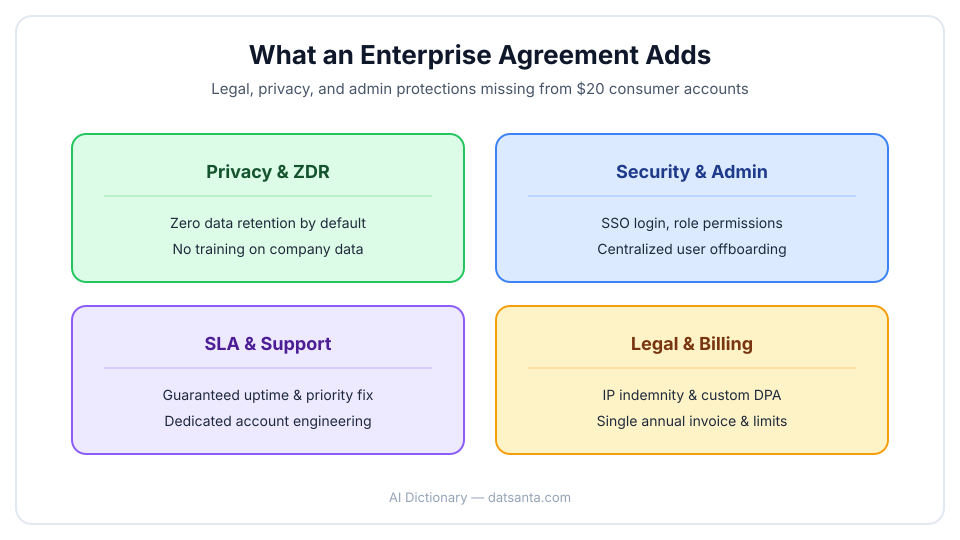

# Enterprise Agreement

An **enterprise agreement** is a formal business contract with an AI provider that adds legal protections, privacy guarantees, central billing, admin controls, and uptime commitments missing from consumer plans.

## Everyday example

Buying a $20 individual streaming or chat subscription with a personal credit card does not give a company single sign-on, legal indemnity, or a promise not to train on company files. An enterprise agreement is the business-grade contract: it locks in zero data retention, data residency, volume pricing, SLA uptime guarantees, and centralized user management when employees join or leave.

## Don't confuse with

- **[SLA](sla.md):** An SLA is the technical promise about uptime and response speed; an enterprise agreement is the full legal and commercial contract that includes the SLA plus privacy, billing, and liability terms.

## Related terms

- [Zero Data Retention](zero-data-retention.md)
- [Vendor Lock-in](vendor-lock-in.md)
- [SLA](sla.md)
