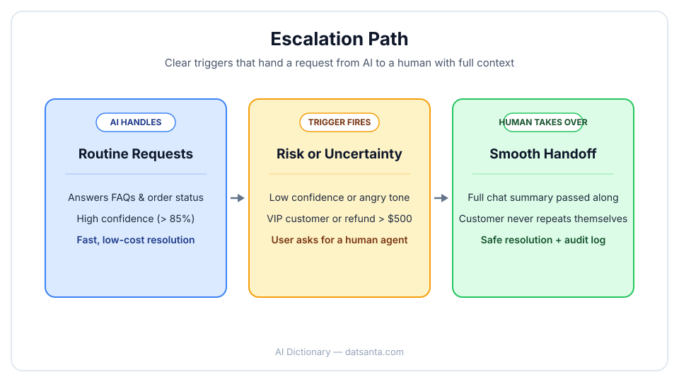

# Escalation Path

An **escalation path** is a clear rule for when an AI system must stop trying to handle a request on its own and hand it over to a human—along with who receives it and what context gets passed along.

## Everyday example

A clinic's automated phone menu can book routine checkups, but the moment a caller mentions chest pain or asks twice for a nurse, the system immediately transfers the call to a live staff member with the caller's name on screen. In AI support or finance tools, an escalation path catches low confidence, angry customers, or high-value exceptions before small mistakes become costly crises.

## Don't confuse with

- **[Human-in-the-Loop](human-in-the-loop.md):** Human-in-the-loop is the broad design where people review or guide AI; an escalation path is the specific trigger and handoff route when AI gets stuck.

## Related terms

- [SLA](sla.md)
- [Service Tiering](service-tiering.md)
- [Guardrails](guardrails.md)
