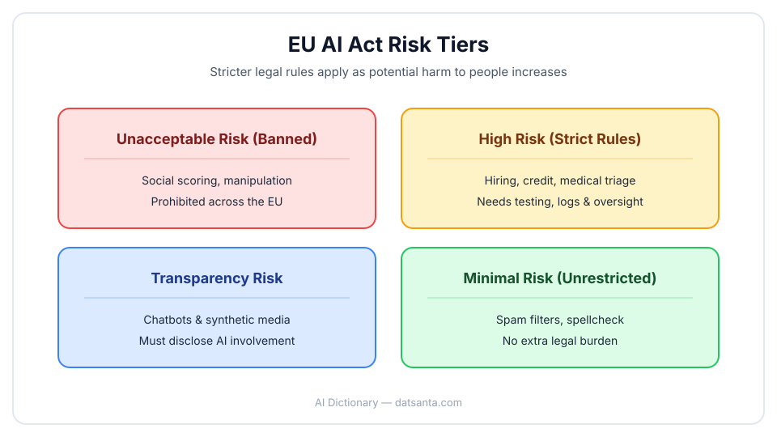

# EU AI Act

The **EU AI Act** is the European Union's landmark law that regulates AI systems based on how much risk they pose to people's safety, rights, and livelihoods—applying to any business serving customers in Europe.

## Everyday example

Car safety laws do not treat a bicycle bell the same way as a commercial airplane brake system. The EU AI Act uses four risk tiers: banning manipulative or social-scoring AI outright, placing strict testing and transparency rules on high-risk uses like hiring or medical triage, requiring clear disclosure for chatbots, and leaving low-risk tools like spam filters mostly untouched.

## Don't confuse with

- **[Compliance](compliance.md):** Compliance is the general practice of following all relevant laws; the EU AI Act is one specific, major regulation shaping global AI standards.

## Related terms

- [AI Disclosure](ai-disclosure.md)
- [Model Risk Management](model-risk-management.md)
- [Audit Trail](audit-trail.md)
