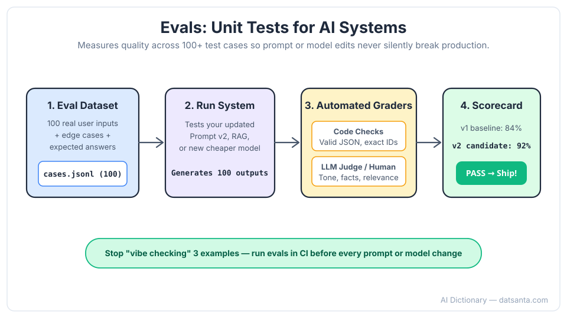

# Evals (Evaluations)

**Evals** are automated test suites that measure how well your AI feature performs across dozens or hundreds of real test cases before you deploy prompt, model, or [RAG](rag.md) changes.

## Everyday example

Software engineers never ship backend changes after testing one happy-path request by eye — yet many teams tweak a [prompt](prompt.md), check three examples ("vibe checking"), and push to production.

Evals fix that: you run 100 saved inputs (including tricky edge cases) through your updated pipeline, score outputs using deterministic code assertions plus [LLM-as-a-Judge](llm-as-a-judge.md), and verify accuracy rose from 84% to 92% with zero regressions.

## Don't confuse with

- **Traditional unit tests:** Unit tests assert exact `assert x == 42` equality; AI evals measure probabilistic pass rates and quality rubrics across varied phrasing.
- **Model benchmarks (MMLU, SWE-bench):** Public leaderboards test generic models; *your* evals test your exact prompts, private data, and user edge cases.

## Related terms

- [LLM-as-a-Judge](llm-as-a-judge.md)
- [Structured Outputs](structured-outputs.md)
- [Prompt](prompt.md)
- [RAG](rag.md)
