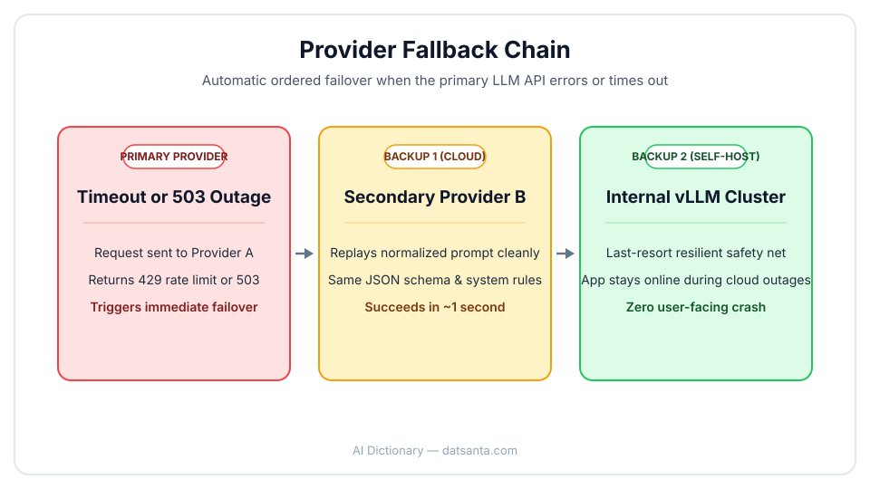

# Fallback Chain

A **fallback chain** is an ordered backup list of LLM providers or models that your application automatically tries in sequence if the primary model times out, hits a [rate limit](rate-limiting.md), or returns a `5xx` outage error.

## Everyday example

If your primary delivery courier's trucks break down on Friday afternoon, your dispatch system immediately hands the package to Courier B—or a smaller local runner—so the customer still gets their order on time. In production AI, a fallback chain (`Primary: Provider A -> Backup 1: Provider B -> Backup 2: Self-hosted vLLM`) turns upstream cloud outages into invisible 1-second hiccups instead of app crashes.

## Don't confuse with

- **[Model Routing](model-routing.md):** Model routing picks the best model upfront based on task difficulty and cost; a fallback chain is an error-recovery ladder triggered when a healthy call fails.

## Related terms

- [AI Gateway](ai-gateway.md)
- [Circuit Breaker](circuit-breaker.md)
- [SLA](sla.md)
