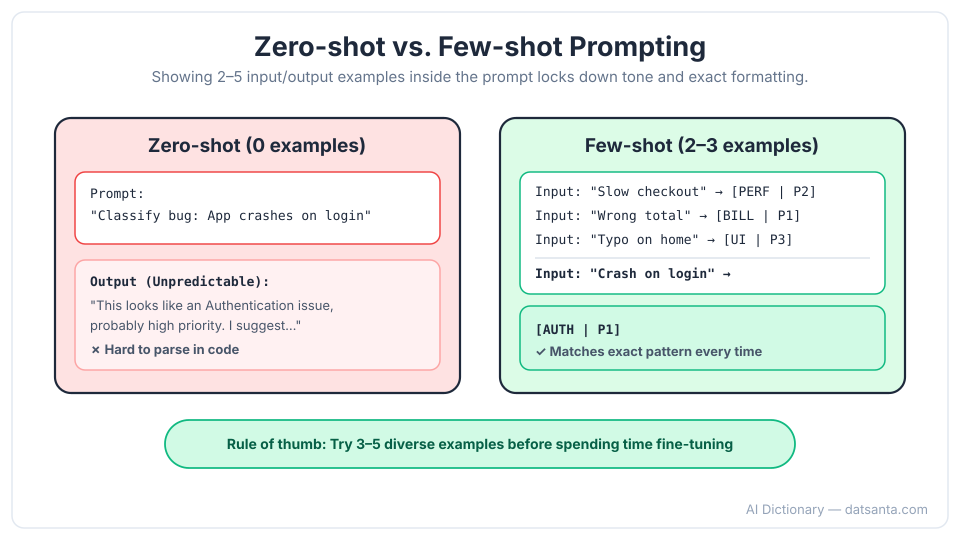

# Few-shot Prompting

**Few-shot prompting** means placing 2 to 5 concrete input/output examples directly inside your [prompt](prompt.md) so the [LLM](llm.md) learns your exact tone, edge-case logic, and formatting pattern on the fly.

## Everyday example

Asking an intern *"Tag these bug tickets"* (zero-shot) invites messy guesses. Instead, handing them three filled-out cards — `"Slow checkout" → [PERF | P2]`, `"Wrong total" → [BILL | P1]`, `"Home typo" → [UI | P3]` — makes the expected pattern unmistakable.

In production code, adding 3–5 well-chosen examples often boosts accuracy and format consistency dramatically in five minutes, without touching [fine-tuning](fine-tuning.md).

## Don't confuse with

- **Zero-shot prompting:** Asking the model directly with zero examples; faster to write, but far less consistent on custom schemas or tricky classifications.
- **[Fine-tuning](fine-tuning.md):** Fine-tuning permanently updates model weights on hundreds or thousands of examples; few-shot happens purely inside the current [context window](context-window.md).

## Related terms

- [Prompt](prompt.md)
- [Structured Outputs](structured-outputs.md)
- [Fine-tuning](fine-tuning.md)
- [Context Window](context-window.md)
