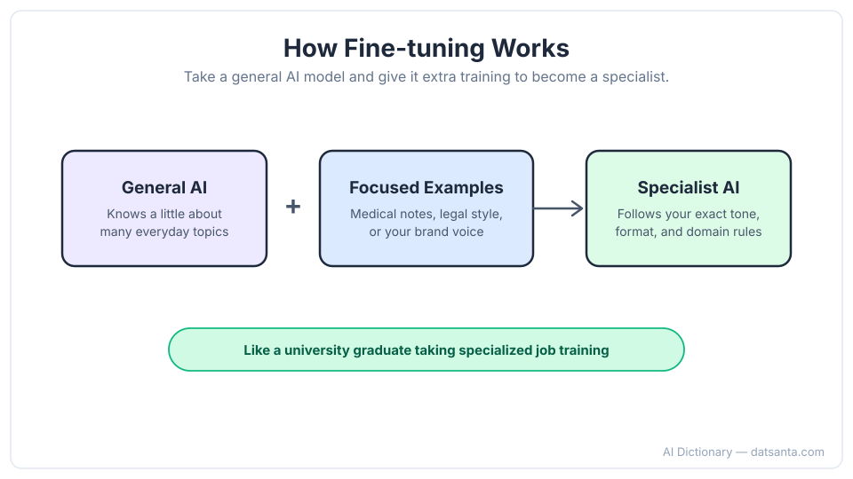

# Fine-tuning

**Fine-tuning** is taking a general AI model and training it a bit more on your own examples so it becomes a specialist. It helps the AI match a specific tone, format, or industry task consistently.

## Everyday example

Think of a fresh medical school graduate starting a residency in heart surgery. They already know general medicine from years of study, so you do not teach them from scratch — you just give them focused practice in one specialty.

Similarly, you take an existing [LLM](llm.md) and feed it hundreds of your past customer support replies or legal summaries so it naturally adopts your exact style.

## Don't confuse with

- **[RAG](rag.md):** Use RAG when you want AI to know up-to-date facts or private documents; use fine-tuning when you want AI to learn a consistent style, tone, or output structure.
- **[Prompt](prompt.md):** Prompting gives instructions for one chat without changing the model; fine-tuning updates the model itself for every future request.

## Related terms

- [Machine learning](machine-learning.md)
- [RAG](rag.md)
- [LLM](llm.md)
