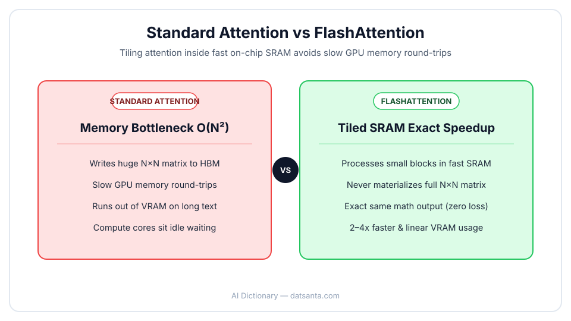

# FlashAttention

**FlashAttention** is an exact, GPU-memory-aware algorithm for computing attention by tiling small blocks into fast on-chip SRAM instead of repeatedly reading and writing huge attention matrices to slower GPU memory.

## Everyday example

Suppose a chef needs to mix 10,000 ingredients. Walking back and forth to a warehouse across the street for every single spoonful wastes 90% of the day. Keeping a small prep bowl right on the cutting board and finishing each batch there is dramatically faster—and produces the exact same dish. FlashAttention cuts memory usage from quadratic to linear, unlocking long context windows without approximations.

## Don't confuse with

- **[Quantization](quantization.md):** Quantization shrinks model weights by lowering numerical precision (small accuracy trade-off); FlashAttention computes *exact* attention faster purely by optimizing GPU memory access.

## Related terms

- [Attention Mechanism](attention-mechanism.md)
- [VRAM](vram.md)
- [Context Window](context-window.md)
