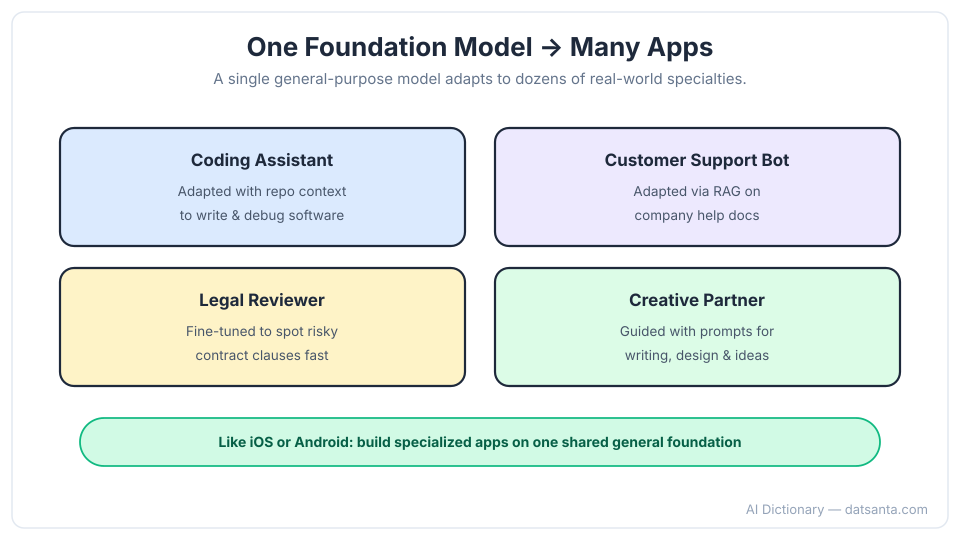

# Foundation Model

A **foundation model** is a large, general-purpose AI model trained on massive, broad data so it can handle many different tasks — and serve as the starting base for specialized apps.

## Everyday example

Think of a smartphone operating system like iOS or Android. Developers do not build a new phone from scratch just to create a weather app or a banking app — they build on top of one shared foundation.

Similarly, one foundation model (like GPT, Claude, or Gemini) can be adapted via [prompts](prompt.md), [RAG](rag.md), or [fine-tuning](fine-tuning.md) into a coding assistant, a legal reviewer, or a customer-support bot.

## Don't confuse with

- **[LLM](llm.md):** Most foundation models today are LLMs, yet a foundation model can also be [multimodal](multimodal-ai.md) (handling images, video, audio, or robotics — not just text).
- **Task-specific AI:** Older AI models could only do *one* job (such as spotting spam); foundation models handle hundreds of tasks right out of the box.

## Related terms

- [LLM](llm.md)
- [Multimodal AI](multimodal-ai.md)
- [Fine-tuning](fine-tuning.md)
- [Open-Source AI](open-source-ai.md)
