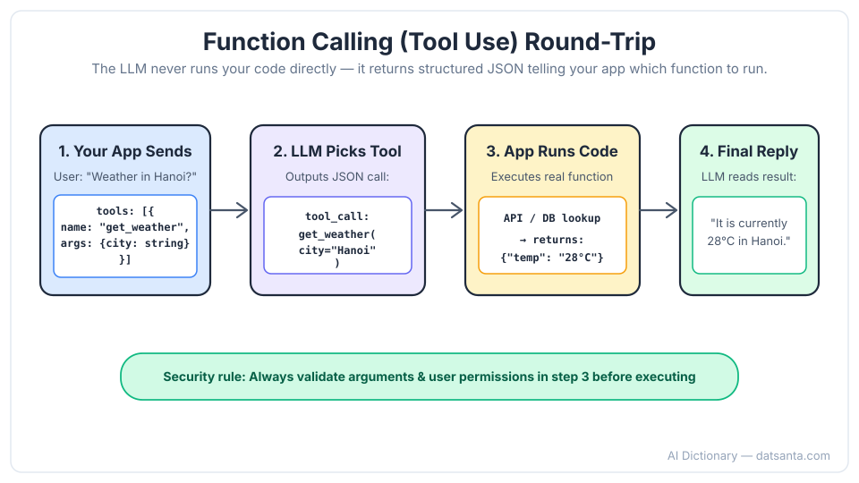

# Function Calling (Tool Use)

**Function calling** lets an [LLM](llm.md) emit structured JSON naming a specific function and its arguments so your application code can execute a real action (database query, API call) and feed the result back.

## Everyday example

Think of a chef (the LLM) who cannot walk into the walk-in freezer. You hand them a checklist of runners (`get_weather`, `query_order`). When a diner asks *"Weather in Hanoi?"*, the chef hands back a slip: `get_weather(city="Hanoi")`.

Your backend executes the actual weather API call, hands `{"temp": "28°C"}` back to the LLM, and the LLM writes the final human-friendly reply.

## Don't confuse with

- **The LLM executing code itself:** The model *never* touches your database directly; it only outputs a JSON request that your app validates and executes safely.
- **[MCP](mcp.md):** Function calling is the model API feature for picking tools; MCP is the standardized protocol for discovering and hosting those tools across apps.

## Related terms

- [Structured Outputs](structured-outputs.md)
- [MCP](mcp.md)
- [ReAct Pattern](react-pattern.md)
- [AI Agent](ai-agent.md)
