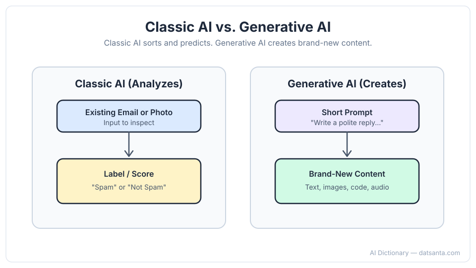

# Generative AI

**Generative AI** is a type of AI that creates brand-new content — such as text, images, code, audio, or video — based on a short instruction from you. Earlier AI mostly sorted or labeled existing things; generative AI produces something new.

## Everyday example

Think of the difference between a food critic and a chef. Classic AI is like the food critic: it tastes a dish and gives it a label (*"too salty"* or *"5 stars"*). Generative AI is like the chef: you ask for *"a quick vegetarian dinner with tomatoes,"* and it cooks up a new dish from scratch.

Tools like ChatGPT, Midjourney, and Suno are all examples of generative AI.

## Don't confuse with

- **[AI](ai.md):** AI also covers older systems that detect spam, recommend movies, or spot credit card fraud without creating new content.
- **[LLM](llm.md):** A specific type of generative AI that specializes in text; generative AI also includes image, video, and music tools.

## Related terms

- [AI](ai.md)
- [LLM](llm.md)
- [Prompt](prompt.md)
- [Hallucination](hallucination.md)
