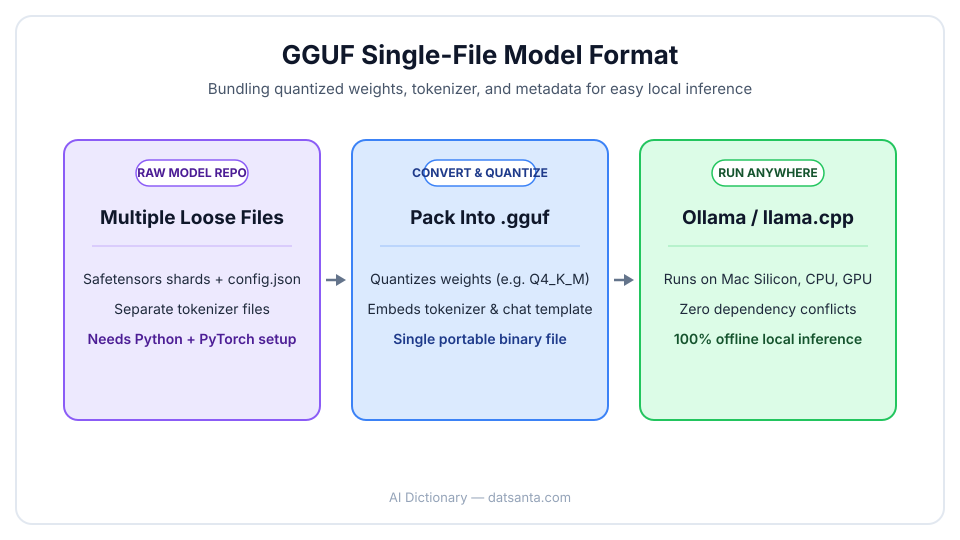

# GGUF Format

**GGUF** is a single-file binary format created for `llama.cpp` that bundles a quantized open-weights model, its tokenizer, and architecture metadata together so it runs cleanly on laptops, CPUs, and Apple Silicon.

## Everyday example

Shipping a raw PyTorch model often feels like buying flat-pack furniture with 12 separate boxes, missing screws, and Python version conflicts. A `.gguf` file is a single self-contained executable-ready package (`qwen-7b-Q4_K_M.gguf`)—download one file, load it into [Ollama](ollama.md) or `llama.cpp`, and run local inference offline with zero dependency headaches.

## Don't confuse with

- **[Quantization](quantization.md):** Quantization is the compression technique (e.g., 4-bit `Q4_K_M`); GGUF is the portable file container format used to store and distribute those quantized weights.

## Related terms

- [Quantization](quantization.md)
- [Ollama](ollama.md)
- [Inference](inference.md)
