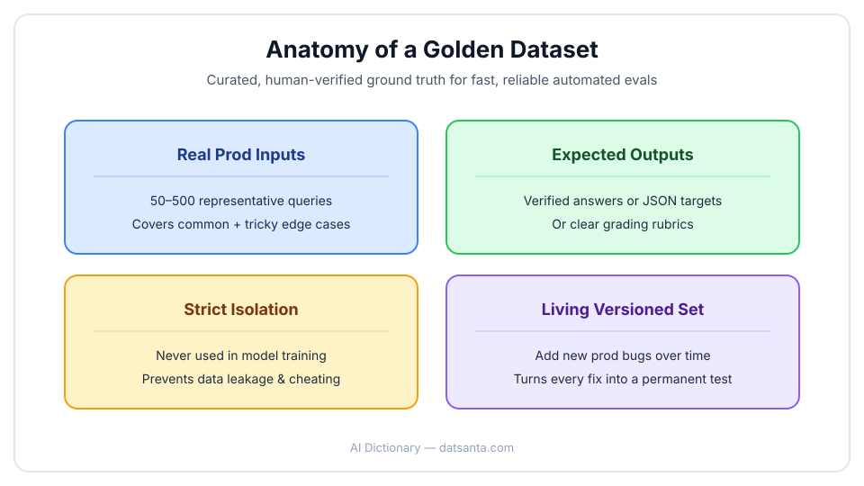

# Golden Dataset

A **golden dataset** is a curated, human-verified collection of representative inputs and expected answers (or grading rules) used as the ground-truth benchmark whenever you change prompts, models, or [RAG](rag.md) settings.

## Everyday example

Before shipping a new espresso machine firmware update, a factory runs the exact same 50 standard coffee tests—measuring temperature, pressure, and shot weight—rather than tasting one random cup. A golden dataset (often 50–500 real production edge cases) lets engineers run automated [evals](evals.md) in minutes to prove a prompt tweak actually improved quality overall.

## Don't confuse with

- **[Training Data](training-data.md):** Training data teaches a model *how* to behave during fine-tuning; a golden dataset stays strictly separate as a clean exam to *measure* accuracy without cheating.

## Related terms

- [Evals (Evaluations)](evals.md)
- [Regression Testing](regression-testing.md)
- [LLM-as-a-Judge](llm-as-a-judge.md)
