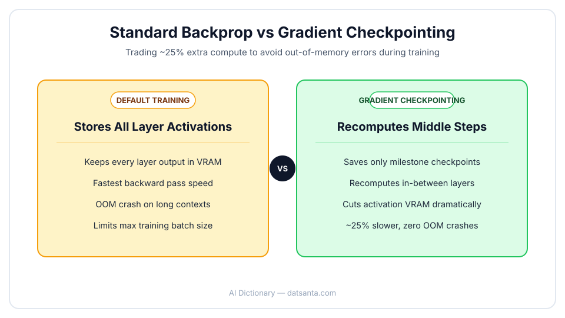

# Gradient Checkpointing

**Gradient checkpointing** is a training optimization that frees GPU memory by discarding most intermediate activations during the forward pass and recomputing them on the fly during backpropagation.

## Everyday example

When solving a 50-step math proof on a tiny whiteboard, you do not have room to keep all 50 scratch lines written down at once. Instead, you write down only the milestone numbers every 10 steps, erase the rest, and quickly re-derive the in-between steps when checking backward. You trade roughly 20–30% extra compute time to fit much larger batch sizes or longer sequences into [VRAM](vram.md).

## Don't confuse with

- **[KV Cache](kv-cache.md):** KV cache speeds up *inference* by storing past tokens in memory; gradient checkpointing saves memory during *training* by recomputing activations instead of storing them.

## Related terms

- [VRAM](vram.md)
- [QLoRA](qlora.md)
- [Fine-tuning](fine-tuning.md)
