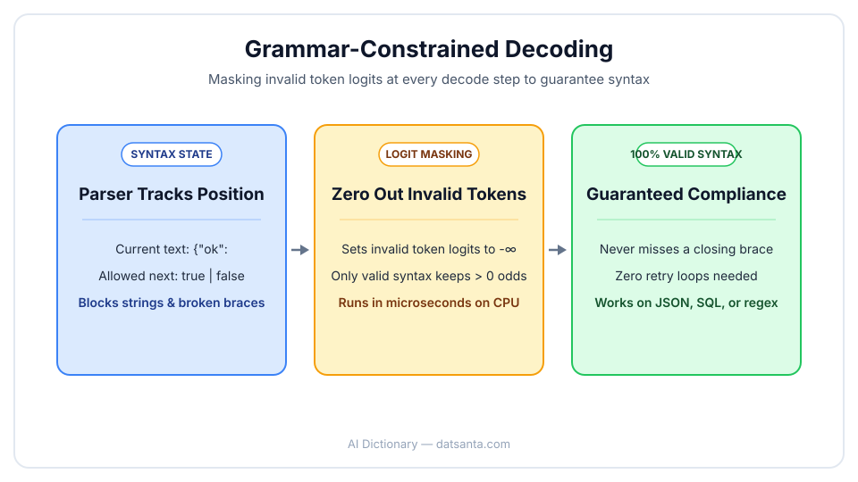

# Grammar-Constrained Decoding

**Grammar-constrained decoding** enforces a strict syntax rule (such as a [JSON Schema](json-schema.md) or regex) at every token step by masking out invalid [logits](logits.md) before sampling, guaranteeing valid output syntax 100% of the time.

## Everyday example

Think of an ATM keypad that disables every letter key and invalid button when asking for a 4-digit PIN—you physically cannot type a letter even if you try. At decode time, a finite-state machine tracks where the JSON is (`{"status": "`), blocks any token that would break the JSON syntax, and only lets valid enum options pass through.

## Don't confuse with

- **[Prompt Engineering](prompt-engineering.md):** Prompting *asks* the model politely to return valid JSON (and it can still slip up); grammar-constrained decoding *mathematically blocks* invalid syntax tokens during generation.

## Related terms

- [JSON Schema](json-schema.md)
- [Structured Outputs](structured-outputs.md)
- [Logits](logits.md)
