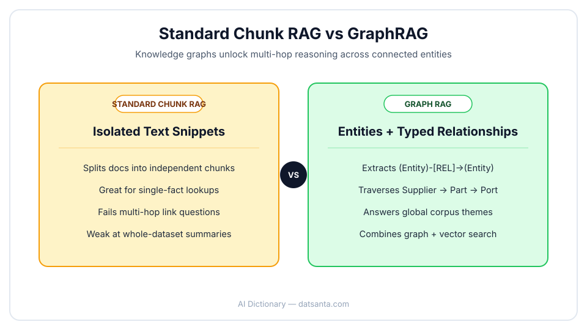

# GraphRAG

**GraphRAG** combines a knowledge graph (entities and typed relationships) with vector retrieval so an LLM can answer multi-hop or global summary questions across an entire dataset, not just isolated text chunks.

## Everyday example

Standard chunk-based [RAG](rag.md) struggles when asked `"Which suppliers sell parts used in products delayed by Port B?"`, because no single paragraph holds all three links. GraphRAG extracts entities (`Supplier -> supplies -> Part -> used_in -> Product -> ships_via -> Port B`) into a graph, traverses connected hops cleanly, and hands the LLM complete relational context.

## Don't confuse with

- **[Vector Database](vector-database.md):** Vector databases find semantically similar text snippets; GraphRAG stores explicit entity-relationship links for multi-hop reasoning and corpus-wide themes.

## Related terms

- [RAG](rag.md)
- [Agentic RAG](agentic-rag.md)
- [Hybrid Search](hybrid-search.md)
