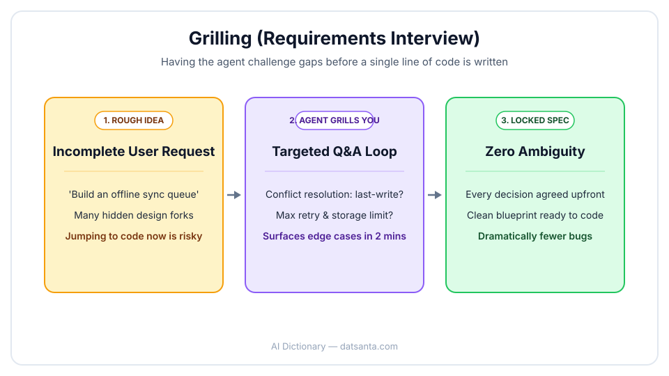

# Grilling (Requirements Interview)

**Grilling** is instructing an AI agent to interview you with tough, specific follow-up questions about edge cases, trade-offs, and architecture *before* it writes any code, exposing hidden ambiguities early.

## Everyday example

A great tailor never cuts expensive fabric after hearing only `"make me a suit"`—they ask about fit, pocket style, lining, and occasion first. Because LLMs default to guessing when requirements are vague, asking the agent to `"grill me on every unclear decision before writing the spec"` forces hidden assumptions into the open while changes still take ten seconds instead of ten refactored files.

## Don't confuse with

- **[Spec](spec.md):** Grilling is the interactive Q&A *process* that uncovers missing decisions; the spec is the finished written *document* produced once those questions are answered.

## Related terms

- [Spec](spec.md)
- [Sycophancy](sycophancy.md)
- [Planning Pattern](planning-pattern.md)
