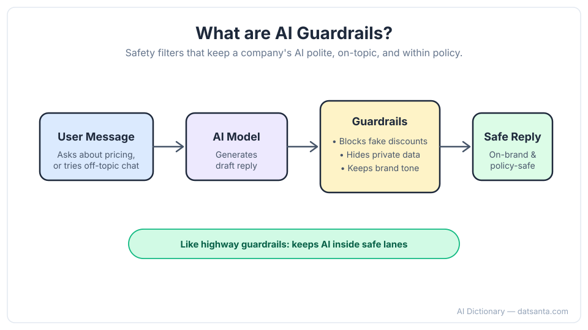

# Guardrails

**Guardrails** are safety rules and automated filters placed around a company's AI system to stop it from saying off-brand, rude, inaccurate, or risky things to users.

## Everyday example

Think of the metal barriers along a mountain highway. They do not steer the car for you, but if the car drifts too close to the cliff edge, the guardrail keeps it safely on the road.

For a business chatbot, guardrails block the AI from promising fake 80% discounts, leaking private customer phone numbers, or arguing with an angry buyer — catching mistakes before the reply ever appears on screen.

## Don't confuse with

- **[Prompt](prompt.md):** A prompt asks the AI to behave nicely, which the AI can still forget or be tricked into ignoring; guardrails are strict checks enforced outside the model's reply.
- **[AI governance](ai-governance.md):** Governance is the company's human policy; guardrails are the technical safety checks running in software.

## Related terms

- [Prompt Injection](prompt-injection.md)
- [Human-in-the-Loop](human-in-the-loop.md)
- [Hallucination](hallucination.md)
