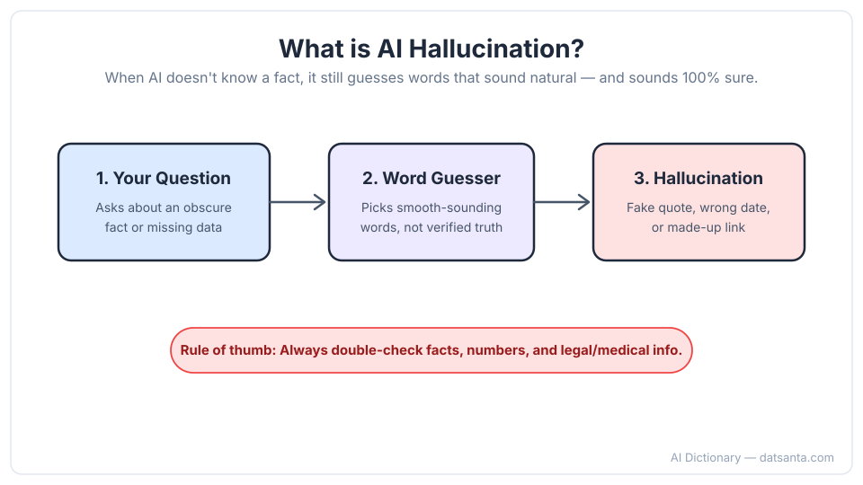

# Hallucination

A **hallucination** happens when an AI makes up false information — such as a fake quote, wrong date, or non-existent web link — and states it with complete confidence.

## Everyday example

Imagine asking a smooth-talking acquaintance for directions in a city they barely know. Instead of admitting *"I'm not sure,"* they invent a street name that sounds plausible and point you down the road with a big smile.

Because an [LLM](llm.md) is built to predict natural-sounding words rather than check facts, it will sometimes fill in missing knowledge with convincing fiction.

## Don't confuse with

- **A software bug:** A crash or broken button is a code error; hallucination is built into how language models guess the next likely word.
- **Lying:** AI has no intention to deceive — it does not know what is true or false, only which words usually go together.

## Related terms

- [LLM](llm.md)
- [RAG](rag.md)
- [Generative AI](generative-ai.md)
