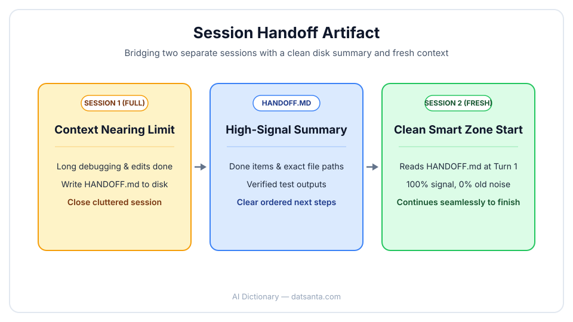

# Handoff Artifact

A **handoff artifact** is a concise Markdown summary written to disk at the end of a long coding session—capturing completed work, key file paths, verified facts, and exact next steps—so a fresh session can pick up seamlessly with a clean [context window](context-window.md).

## Everyday example

When a hospital nurse finishes a 12-hour shift, they do not dump 400 raw monitor printouts on the next nurse; they hand over a crisp one-page shift note covering current vitals, medications given, and what to check at 8 AM. Writing a handoff artifact before resetting an AI chat gives the next session 100% of the signal inside the [smart zone](smart-zone.md) with zero dead-end noise.

## Don't confuse with

- **[Compaction](compaction.md):** Compaction summarizes history inside the *current* session; a handoff artifact lets you close the cluttered session completely and start fresh from a clean file.

## Related terms

- [Compaction](compaction.md)
- [Smart Zone](smart-zone.md)
- [Checkpointing](checkpointing.md)
